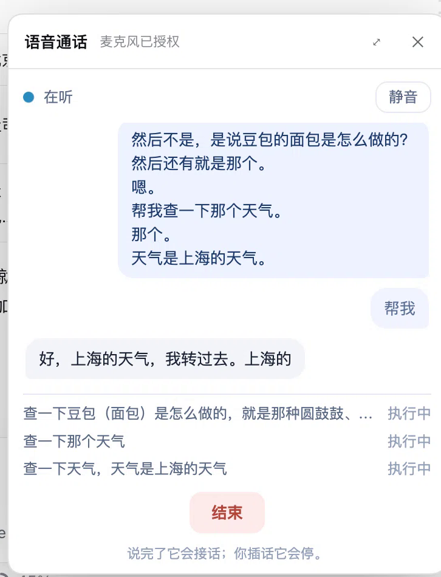

# dsh-moss-live

**Full-duplex voice for [DeepSeek Harness](https://github.com/deepseek-ai/deepseek-harness).**

A phone button next to the composer opens a small call panel. You speak, MOSS-Live
answers out loud, and anything that needs real work is delegated to the DSH agent —
which figures out *how* to do it (immediately, in the background, or as a scheduled
task) and runs it in a subagent.



```
you speak ──► MOSS-Live (full duplex, barge-in)
                 │  dsh_task(objective)          ← text only
                 ▼
           DSH main agent (decides, clarifies, schedules)
                 │  spawn
                 ▼
              subagent (tools, files, shell, web)
                 │  final text
                 ▼
           MOSS speaks the answer
```

The wrapper is thin on purpose. Capture, playback, barge-in and playback
acknowledgements are MOSS's own browser demo; the harness only adds a local relay
that holds the API key, one tool call, and the subagent runner.

## How it works

| Layer | Owns | Talks to the next layer with |
|---|---|---|
| MOSS-Live (front) | listening, speaking, interruptions | one async tool call |
| Relay (this plugin) | API key, protocol translation, call log | `sessionController.prompt` + subagents |
| DSH main agent | clarification, planning, scheduling | child agents |
| Subagents | the actual work | final text |

Two tools are registered on each call session:

- `dsh_task(objective)` — forward one request; the agent decides how to execute it.
- `dsh_tasks()` — summarize what is running and what finished.

While a task runs the user keeps talking; results are spoken as they land. A task
that outlives MOSS's 120 s tool window gets an immediate "on it" and its result is
delivered later as commentary.

## Install

Requirements: DeepSeek Harness with a MOSS API key (from the MOSS console at
`platform.mosi.cn`, model `moss-live-1.0`), Node.js ≥ 22.19.

### From npm

The package is on npm as **`dsh-moss-live`**:

```bash
npm install dsh-moss-live
```

Then install it as a bundle in your DSH profile, using the absolute path:

```text
plugin_manager action=install_bundle target=/absolute/path/to/node_modules/dsh-moss-live
```

### From the plugin market

```bash
dsh plugin --profile web add dshmarket
```

Then install `dsh-moss-live` from the market.

### From a git clone

```bash
git clone https://github.com/HudsonHuang/dsh-moss-live.git
cd dsh-moss-live
npm ci            # required — see the note below
```

Then register that directory as a bundle:

```text
plugin_manager action=install_bundle target=/absolute/path/to/dsh-moss-live
```

`install_bundle` **links** a local directory into the profile (`pnpm link:`); it
does not install that directory's dependencies. The plugin's runtime imports
`ws` and `@mossai/mosslive` at load, so a clone without `npm ci` is recorded as
installed and then fails on first use; the panel names the missing package, and
`npm run doctor` prints the exact command.

Finally reload the plugin row if needed, refresh the DSH page, and click the phone
button next to the composer.

Put your MOSS key in one of these places:

1. `.moss-api-key` in the plugin directory (one line, mode 600), or
2. the `apiKey` field of the plugin config, or
3. the `MOSS_API_KEY` environment variable.

## Verify before the first call

Run it from the plugin directory (the clone, or `node_modules/dsh-moss-live` after
`npm install`):

```bash
npm run doctor
```

It checks the Node version, required files, `ws`/`@mossai/mosslive` resolution,
the vendored relay's module load, the relay port (default `127.0.0.1:17861`), the
key, and — unless `--offline` — one real MOSS WebSocket handshake plus
`attach_session` (an empty session, no audio).

It exits non-zero on failure and prints the fix. A pass covers only the checks
printed as `[ok]`: it does **not** test audio, microphone permission, DSH
delegation, the desktop shell's iframe microphone injection, or billing/quotas.
Those are printed as not covered, and `--offline` explicitly says the key and
reachability were not verified. There is no blanket "all checks passed" line.

If the key exists only in the plugin's `apiKey` config, the CLI cannot read it;
pass `--key-file <path>` or set `MOSS_API_KEY` for the handshake check.

## Configuration

| Field | Default | Meaning |
|---|---|---|
| `apiKey` | — | MOSS API key (overrides the file/env) |
| `keyFile` | `.moss-api-key` | Key file, relative to the plugin directory |
| `listen` | `127.0.0.1:17861` | Local relay address |
| `mossUrl` | `wss://api.mosi.cn/v1/realtime` | Upstream endpoint |
| `model` | `moss-live-1.0` | Realtime model |
| `sessionTimeoutMs` | `180000` | How long a task may take before the agent reports back |

## Calls are recorded

Every call writes `calls/YYYYMMDD-HHMMSS.md` (transcript, dispatched tasks, results)
and leaves a single line with that path in the conversation. An append-only
`.calls/YYYY-MM-DD.jsonl` keeps the raw stream. Both stay local.

## Troubleshooting

| Symptom | Fix |
|---|---|
| `ERR_MODULE_NOT_FOUND: Cannot find package 'ws'` | You installed from a clone without `npm ci`. Run it in the plugin directory and reload the plugin. `npm run doctor` reports this as well. |
| Panel says MOSS rejected the key (HTTP 401/403) | Set the key in plugin config `apiKey`, `MOSS_API_KEY`, or `.moss-api-key` (one line), then start the call again. |
| Panel says it cannot reach MOSS | Check network/proxy and `mossUrl` (default `wss://api.mosi.cn/v1/realtime`); run `npm run doctor`. |
| `EADDRINUSE` / port 17861 is busy | Change the plugin's `listen` to `127.0.0.1:17862`; or find the owner with `lsof -nP -iTCP:17861 -sTCP:LISTEN` (macOS/Linux) or `netstat -ano | findstr :17861` (Windows) and stop it. |
| `PUBLIC_WSS_URL_REQUIRED` | `mossUrl` must be `wss://` (loopback `ws://` only for development), with no credentials, query or hash. |
| `API_KEY_REQUIRED` | The key is empty or contains a newline; write exactly one line. |

## Known limits

- **Doctor is not a call test.** It checks everything up to `attach_session`; it does
  not send audio or exercise the microphone, DSH delegation or billing.
- **One call at a time** — the demo relay is single-session by design.
- **Microphone permission lives in the parent page.** The desktop shell's
  `dsh-app://` origin is not a secure context, so the harness page captures audio and
  hands the stream to the call page. In a plain browser the call page can capture on
  its own.
- **The front model still decides.** It is instructed to forward everything except
  pleasantries, and to clarify before forwarding an under-specified request, but that
  is a prompt, not a guarantee.
- **Results are capped at 2000 characters** on the way back to the voice layer.
- **MOSS's voice, not DeepSeek's** — the mouth is MOSS-Live, the brain is DSH.

## Layout

```
index.js              Host half: relay lifecycle, session policy, delegation → subagents
client.js             Client half: the phone button and the in-app panel
vendor/runtime/       MOSS browser demo relay (MIT), with the wrapper changes below
vendor/web/           MOSS demo front end + a purpose-built compact call page
test/                 Error-message tests + delegation / barge-in end-to-end scripts
```

Wrapper changes inside `vendor/` (everything else is upstream):

1. `runtime/server.mjs` — session policy + tools injected after `session_attached`,
   `dsh_task`/`dsh_tasks` handling, delegation to `run()`, per-call log, pinned token,
   harness origin allowed; failed MOSS handshakes are classified (auth vs network)
   and sent to the page as `relay.error` before the socket is closed.
2. `web/js/mic.js` — prefer a stream injected by the parent page.
3. `web/js/client-demo.js` — keep the query string, report real errors, relay override.
4. `web/product/embed.html`, `web/js/embed-app.js`, `web/product/embed.css` — the
   compact panel UI (new, not upstream); `embed-app.js` shows the relay's actionable
   error and the microphone guidance instead of a generic disconnect message.

## Credits

Built on [`@mossai/mosslive`](https://www.npmjs.com/package/@mossai/mosslive) 0.1.0 and
its `examples/browser-demo` (MIT — see `vendor/LICENSE`). MOSS-Live is a product of
MOSS / OpenMOSS. DeepSeek Harness is a DeepSeek project. This repository is an
independent integration, not affiliated with either.

## License

MIT — see [LICENSE](LICENSE).
